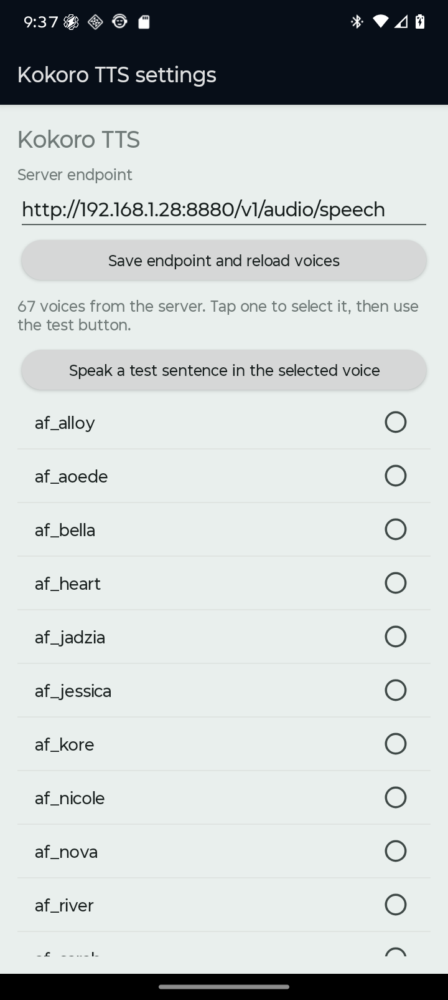

# Kokoro Android system TTS driver

An Android **system TTS engine** (`TextToSpeechService`) that speaks through a
Kokoro server, with the text analysis done **on the device and tuned to Kokoro
specifically** rather than treating the API as a generic HTTP endpoint.

## Why this is not just an HTTP client

Kokoro's hard input limit is **510 phoneme tokens**
(`kokoro/pipeline.py:274-275`, from `plbert.max_position_embeddings = 512` minus BOS
and EOS), and the server counts the length of the **IPA phoneme string**, not
characters. Character count is a bad proxy for it, measured on 2026-10-12:

| input class | measured tokens/char |
| --- | ---: |
| English prose | ~1.00 |
| digit / money dense | ~3.2–3.5 |
| CJK read by its own pipeline | ~4.0 |
| CJK read by the **English** pipeline | ~13.0 |

So upstream's own `chunk_size = 400` *characters* is unsafe: a 42-character Chinese
sentence is 545 phoneme tokens — over the limit — while a character budget sees only
10 % of its allowance used. Measured on a 1.1 M-character corpus, the naive
character-budget splitter emitted **3 chunks above the 510 limit (worst case 672
tokens)**; this driver emitted **zero**, with identical losslessness.

There are **two** failure modes, and they need different guards:

1. **Truncation** — over-long input is silently cut to its first 510 tokens.
2. **Wrong-language phonemisation** — CJK through the English G2P produces a
   per-character fallback that the real server returns as **HTTP 200 with fluent
   nonsense**. No status code reveals it.

## Layout

```
core/     pure Java, no Android imports, unit-testable on a plain JVM
  KokoroSplitter        paragraph -> sentence -> clause -> word -> character cuts
  KokoroCostModel       GENERATED from docs/research/token_model.json
  SentenceBreaker       decimals, versions, abbreviations, CJK terminators
  Emoji                 strips symbols that have no spoken form
  CharBaselineSplitter  the naive 400-char baseline, kept for measurement
android/  the system TTS engine and an adb-driven end-to-end probe
tools/    calibration, model fitting, conformance harness, server probe
docs/     research report, experiment report, raw primary sources
data/     corpora (public domain + authored fixtures)
```

## Build

No Gradle is required — the APK is built with the SDK's own tools
(`aapt2` → `javac` → `d8` → `zipalign` → `apksigner`):

```sh
python3 android/build.py          # -> android/kokoro-tts.apk
bash core/build.sh                # core only, for the JVM harnesses
```

## Test

```sh
# splitter invariants on a plain JVM (no Android, no device)
javac -d core/build/test-classes -cp core/build/classes \
      core/src/test/java/dev/kokoro/tts/SplitterSelfTest.java
java -cp core/build/classes:core/build/test-classes dev.kokoro.tts.SplitterSelfTest

# measure a splitter against real Kokoro G2P ground truth
.tooling/kokoro-venv/bin/python tools/splitter_conformance.py \
    --mode model --corpus data/corpus_mixed.txt \
    --out docs/research/conformance-model.json --check-lossless
```

## Changing the voice

**On the phone:** Settings > System > Languages & input > Text-to-speech output >
**Kokoro TTS** (the gear icon). The screen fetches the voice list live from the
server's `/v1/audio/voices` — the server this was built against offers **67**
voices, so nothing is hardcoded — and has a *Speak a test sentence* button so you
can hear each one before committing. Tapping a voice applies it immediately: the
settings screen and the engine share one process, so the engine sees the new
value on the next utterance.



**From a shell:** `tools/set-voice.sh --list` to see what the server offers, then
`tools/set-voice.sh bm_george`. This writes the preference file directly, which the
running process has cached in memory, so the script force-stops the app afterwards
to make it re-read.

The engine also advertises the fetched list through `onGetVoices()`, so any app
that picks a TTS voice sees all of them rather than a built-in subset.

## Configure the engine

Configuration is read from SharedPreferences (`kokoro`), so it can be set over adb
without a settings UI. Defaults:

| key | default |
| --- | --- |
| `endpoint` | `http://10.0.2.2:8880/v1/audio/speech` |
| `voice` | `af_heart` |
| `model` | `kokoro` |
| `format` | `pcm` |
| `hard_cap` | `360` (estimated tokens — see below) |
| `target_min` / `target_max` | `240` / `360` |
| `mid_sentence_gap_ms` | `90` (seam cut mid-sentence) |
| `paragraph_gap_ms` | `280` (seam at a paragraph break) |

A preference with the wrong type degrades to its default and logs a warning; it never
crashes the engine. That is deliberate — a malformed preference written by hand took the
whole TTS service down on a real device before this was fixed.

### Why the cap is 360 and not 450

The splitter caps *estimated* tokens. The cost model is fitted not to
under-predict, but it is still an estimate: on 11,083 held-out samples the worst
case was a true count **1.348×** the estimate, so a 450 cap could reach 607 real
tokens. The fit's own recommendation is `510 / 1.348 = 378`; the default derates
that ~5 % to **360**. Fit quality: R² 0.949, 1 under-prediction in 11,083 samples,
median over-estimate 1.611×.

## Reports

- `docs/research/2026-10-12-kokoro-text-limits.md` — what the sources support,
  with a licence table and an explicit list of what could **not** be sourced.
- `docs/research/2026-10-12-ao3-reader-chunker-vs-kokoro.md` — the existing
  `ao3-reader` narration chunker, scored by the same referee against real Kokoro
  G2P. It is well calibrated for pace (median 247 tokens) but has **10 chunks
  over 510 tokens on long-form prose and 3 of 41 on the mixed corpus**, because
  `mergeChunks` merges but never splits an oversized sentence, and `chunkText`
  only recognises ASCII terminators.
- `docs/experiments/2026-10-12-kokoro-splitter.md` — the pre-registered
  experiment, **including the criterion that failed** and why.
- `docs/experiments/device-evidence-2026-10-12.md` — raw logcat and verified
  RIFF headers from the on-device runs.

### What the chunk budget is, and is not

Two independent concerns get conflated when picking a chunk size:

* **Pace uniformity** — Kokoro's speaking rate varies with input size, so very
  short chunks sound rushed. `ao3-reader` measured this and chose ~300
  characters; this project reached the same region from the token side (median
  194 true tokens on long-form prose). For English prose the two are nearly the
  same number, because prose is ~1.0 tokens/char.
* **The 510-token ceiling** — a hard limit that a character budget cannot
  enforce, because the cost per character ranges from ~1.0 (prose) to ~13 (CJK).

## Licence

The driver code here is original. It depends at runtime on a Kokoro server;
`hexgrad/kokoro`, `remsky/Kokoro-FastAPI` and the `hexgrad/Kokoro-82M` weights are
all **Apache-2.0** (licence files fetched and recorded in the research report).
`data/corpus_pride_prejudice.txt` is public domain (Project Gutenberg ebook 1342).
