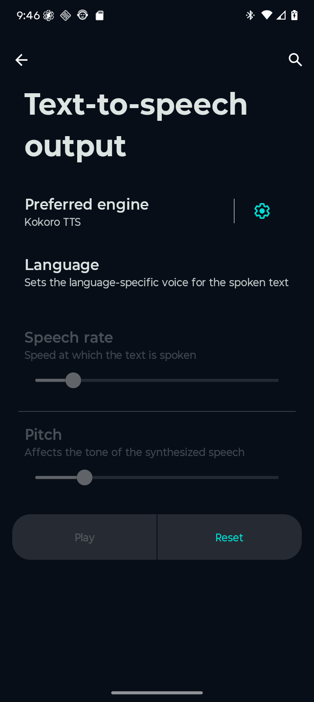
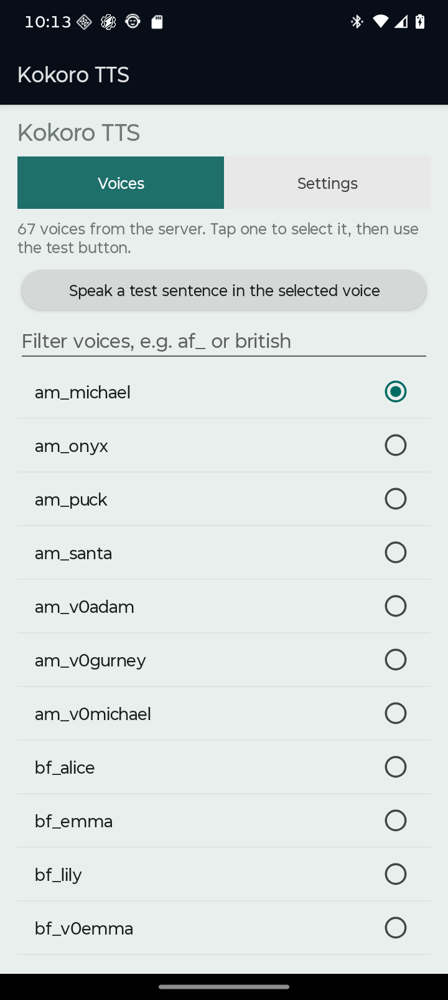
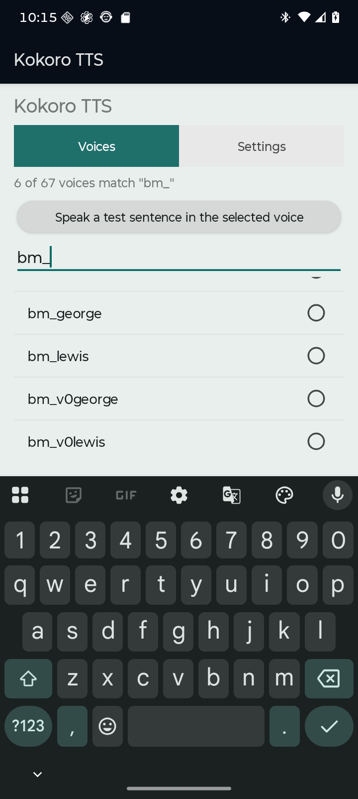
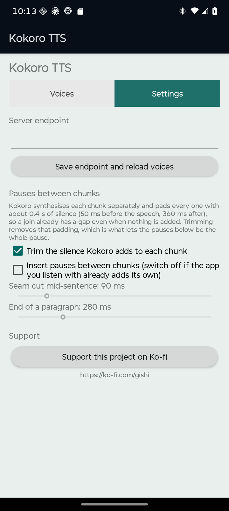

# Kokoro Android system TTS driver

An Android **system TTS engine** (`TextToSpeechService`) that speaks through a
Kokoro server, with the text analysis done **on the device and tuned to Kokoro
specifically** rather than treating the API as a generic HTTP endpoint.

## Why this is not just an HTTP client

Kokoro's hard input limit is **510 phoneme tokens**
(`kokoro/pipeline.py:274-275`, from `plbert.max_position_embeddings = 512` minus BOS
and EOS), and the server counts the length of the **IPA phoneme string**, not
characters. Character count is a bad proxy for it, measured on 2026-10-12:

| input class | measured tokens/char |
| --- | ---: |
| English prose | ~1.00 |
| digit / money dense | ~3.2–3.5 |
| CJK read by its own pipeline | ~4.0 |
| CJK read by the **English** pipeline | ~13.0 |

So upstream's own `chunk_size = 400` *characters* is unsafe: a 42-character Chinese
sentence is 545 phoneme tokens — over the limit — while a character budget sees only
10 % of its allowance used. Measured on a 1.1 M-character corpus, the naive
character-budget splitter emitted **3 chunks above the 510 limit (worst case 672
tokens)**; this driver emitted **zero**, with identical losslessness.

There are **two** failure modes, and they need different guards:

1. **Truncation** — over-long input is silently cut to its first 510 tokens.
2. **Wrong-language phonemisation** — CJK through the English G2P produces a
   per-character fallback that the real server returns as **HTTP 200 with fluent
   nonsense**. No status code reveals it.

## Layout

```
core/     pure Java, no Android imports, unit-testable on a plain JVM
  KokoroSplitter        paragraph -> sentence -> clause -> word -> character cuts
  KokoroCostModel       GENERATED from docs/research/token_model.json
  SentenceBreaker       decimals, versions, abbreviations, CJK terminators
  Emoji                 strips symbols that have no spoken form
  CharBaselineSplitter  the naive 400-char baseline, kept for measurement
android/  the system TTS engine and an adb-driven end-to-end probe
tools/    calibration, model fitting, conformance harness, server probe
docs/     research report, experiment report, raw primary sources
data/     corpora (public domain + authored fixtures)
```

## Build

No Gradle is required — the APK is built with the SDK's own tools
(`aapt2` → `javac` → `d8` → `zipalign` → `apksigner`):

```sh
python3 android/build.py          # -> android/kokoro-tts.apk
bash core/build.sh                # core only, for the JVM harnesses
```

## Test

```sh
# splitter invariants on a plain JVM (no Android, no device)
javac -d core/build/test-classes -cp core/build/classes \
      core/src/test/java/dev/kokoro/tts/SplitterSelfTest.java
java -cp core/build/classes:core/build/test-classes dev.kokoro.tts.SplitterSelfTest

# measure a splitter against real Kokoro G2P ground truth
.tooling/kokoro-venv/bin/python tools/splitter_conformance.py \
    --mode model --corpus data/corpus_mixed.txt \
    --out docs/research/conformance-model.json --check-lossless
```

## If a voice sounds raspy on "s"

Not the format, and not this driver. `response_format=pcm` returns **exactly the WAV
payload** (252,452 − 252,404 = a 48-byte header), so it is the lossless path, and the
engine copies samples verbatim. There is also no aliasing junk below the 12 kHz
Nyquist: 92 % of the energy is below 1 kHz and 11–12 kHz holds 0.0 %.

It is voice-dependent, by a wide margin. Power above 5 kHz, same sentence:

| voice | >5 kHz power | centroid |
| --- | ---: | ---: |
| **am_onyx** | **0.16 %** | 333 Hz |
| am_adam | 1.03 % | 717 Hz |
| am_michael | 2.01 % | 579 Hz |
| af_heart | 3.11 % | 777 Hz |
| bf_emma | 3.23 % | 1,032 Hz |

So **try `am_onyx`** if `am_michael` sounds harsh. Full table and method in
`docs/research/2026-10-12-voice-sibilance.md`. If it persists with a different voice,
check the listening path — Bluetooth with SBC or low-bitrate AAC causes raspy
sibilance independently of the model.

## Inspecting the audio

`tools/waveform.py` renders a waveform PNG so audio can be looked at rather than only
measured — useful for exactly the problems this driver had (a clipped first word, a
seam that is too long, padding that will not go away). It uses numpy and stdlib zlib
only, so there is no matplotlib or Pillow dependency.

```sh
.tooling/kokoro-venv/bin/python tools/waveform.py audio.wav --out wave.png
.tooling/kokoro-venv/bin/python tools/waveform.py audio.wav \
    --out seam.png --start 8.35 --end 9.35 --mark 8.845   # zoom on a known seam
```

The bottom band marks where the signal is below the silence threshold, so gaps read
at a glance. `docs/experiments/audio-inspection.md` works through four examples:
an intact onset, Kokoro's visible padding, a bounded seam, and a whole utterance.

## Performance: where the time actually goes

Measured against a real Kokoro-FastAPI server on 2026-10-12, per chunk. Every
utterance logs these numbers, so this is checkable rather than folklore:

```
KokoroTts: chunk 0/3 chars=156 est=244 send=25ms wait=6ms body=2928ms bytes=436666 trimFront=0ms trimBack=252ms
```

| phase | measured | what it is |
| --- | ---: | --- |
| `send` | 1-25 ms | connection setup and request upload |
| `wait` | 4-30 ms | time to response **headers** |
| `body` | 1.4-2.9 s | the audio itself |

**The cost is server synthesis, not request handling.** Three independent checks:

1. **`wait` is ~5 ms, `body` is seconds.** Kokoro answers with headers immediately
   and `Transfer-Encoding: chunked`.
2. **The body does not actually stream.** Despite the chunked encoding, the first body
   bytes arrive only after synthesis finishes — at 4914 ms for a 9.1 s clip. So there
   is nothing to play early, and a streaming client gains nothing. (An earlier version
   of this engine streamed the body and was reverted for that reason.)
3. **Requests serialise.** Two concurrent requests took 5.03 s each against 2.74 s +
   2.77 s sequential — a ratio of 1.10. The server handles one at a time.

Synthesis runs at roughly **16-20 ms per phoneme token**, linear across the sizes
tried (62 tokens → 1157 ms, 211 → 4299 ms, 235 → 4638 ms). That is about a third of
real time, so playback keeps up comfortably in steady state; what it costs is
**time-to-first-audio**, because the first chunk must be fully synthesised before
anything can be played. Smaller chunks trade more requests for a shorter wait.

### Prefetching

The engine fetches chunk *N+1* while chunk *N* is still being written to the
callback, via a one-deep buffer. This cannot shorten the total or the first chunk's
latency — the server serialises, so nothing can start earlier. What it fixes is
idleness: `audioAvailable()` blocks once the framework's audio buffer fills, and
without prefetching the server would sit unused for the whole time we are writing and
playing the current chunk.

## Changing the voice

**On the phone — two routes:**

1. **App drawer → "Kokoro TTS"** (a launcher icon; the quickest way).
2. **Settings > System > Languages & input > Text-to-speech output → the gear beside
   "Preferred engine: Kokoro TTS".**

 The screen fetches the voice list live from the
server's `/v1/audio/voices` — the server this was built against offers **67**
voices, so nothing is hardcoded — and has a *Speak a test sentence* button so you
can hear each one before committing. Tapping a voice applies it immediately: the
settings screen and the engine share one process, so the engine sees the new
value on the next utterance.

The screen is split into two tabs so the voice list gets the full height rather than
competing with the configuration controls. Voices also has a filter, which matters when a
server offers 67 of them:





Both routes are verified on a real device; see
`docs/experiments/img/settings-from-app-icon.png` and
`docs/experiments/img/settings-from-system-gear.png`.

**From a shell:** `tools/set-voice.sh --list` to see what the server offers, then
`tools/set-voice.sh bm_george`. This writes the preference file directly, which the
running process has cached in memory, so the script force-stops the app afterwards
to make it re-read.

The engine also advertises the fetched list through `onGetVoices()`, so any app
that picks a TTS voice sees all of them rather than a built-in subset.

### Pauses between chunks, and the silence Kokoro adds itself

This is the part that surprises people, so it is worth stating plainly:

**Kokoro pads every chunk with about 0.4 s of silence.** Measured against a real server on
2026-10-12, identical across every input length tried:

| | leading | trailing |
| --- | ---: | ---: |
| every chunk | **50 ms** | **360 ms** |

So a seam between two chunks already carries 360 + 50 = **410 ms** of silence that no
setting asked for. That is why simply turning the engine's own pauses off appeared to do
nothing — the audible gap was never ours. The engine therefore **trims that padding** by
default, cutting at the first and last non-silent sample (which cannot click, because the
cut lands in a run of near-zero samples, and a 10 ms guard is kept either side).

**Trimming keeps a lead-in at the start of the utterance.** The audio output path needs
samples to spin up, and speech that begins at sample zero loses the attack of its first
word. The server's own leading padding was previously hiding that, so trimming it away
without a replacement made the first word clip. The engine therefore keeps 80 ms of
lead-in before the first chunk (measured against a 50 ms padding, so in practice the whole
lead-in survives) and trims normally from the second chunk onward, since those are
mid-stream in one continuous track.

With trimming on, the pause settings control the pause exactly:

| settings | inserted | total audio |
| --- | ---: | ---: |
| trimming on, pauses off | 0 ms | 22.386 s |
| trimming on, pauses on at 200 ms | 400 ms | 22.786 s |

The difference is exactly 400 ms — two seams x 200 ms. Before trimming, the same 200 ms
change was buried under 410 ms of server padding per seam.

| setting | default | meaning |
| --- | ---: | --- |
| `trim_silence` | `true` | strip the 50 ms / 360 ms padding Kokoro adds to each chunk |
| `add_gaps` | `true` | master switch for the pauses below |
| `mid_sentence_gap_ms` | 90 ms | pause where a seam cuts mid-sentence |
| `paragraph_gap_ms` | 280 ms | pause where a seam is a paragraph break |

A seam that already lands on a sentence end gets **no** inserted pause, because the
synthesised audio ends with its own natural pause there. So 90 ms does not mean every join
grows by 90 ms, only the ones that would otherwise run together.

**Turn `add_gaps` off if the app you listen with inserts its own pauses**, or you get both
and the reading sounds choppy. Each utterance logs what it actually did:

```
KokoroTts: synth ok: chars=393 chunks=3 estTokens=244/234/134 voice=af_heart \
           pauses=off inserted=0ms trimmed=1005ms ms=7165
```



### Which voice wins

The engine's own setting is the default for the phone. An app that calls
`TextToSpeech.setVoice()` **after** you last changed the setting gets its choice for
its own session; a voice the framework loaded **before** your change is treated as a
stale default and ignored. That distinction exists because the framework loads a
voice into every client session — including one resolved before you picked — so
honouring it unconditionally made selection appear to do nothing. `onLoadVoice` never
writes the preference; only the settings screen owns it.

## Configure the engine

Configuration is read from SharedPreferences (`kokoro`), so it can be set over adb
without a settings UI. Defaults:

| key | default |
| --- | --- |
| `endpoint` | `http://10.0.2.2:8880/v1/audio/speech` |
| `voice` | `af_heart` |
| `model` | `kokoro` |
| `format` | `pcm` |
| `hard_cap` | `360` (estimated tokens — see below) |
| `target_min` / `target_max` | `240` / `360` |
| `trim_silence` | `true` (strip Kokoro's per-chunk padding) |
| `add_gaps` | `true` (master switch for inserted silence) |
| `mid_sentence_gap_ms` | `90` (seam cut mid-sentence) |
| `paragraph_gap_ms` | `280` (seam at a paragraph break) |

A preference with the wrong type degrades to its default and logs a warning; it never
crashes the engine. That is deliberate — a malformed preference written by hand took the
whole TTS service down on a real device before this was fixed.

### Why the cap is 360 and not 450

The splitter caps *estimated* tokens. The cost model is fitted not to
under-predict, but it is still an estimate: on 11,083 held-out samples the worst
case was a true count **1.348×** the estimate, so a 450 cap could reach 607 real
tokens. The fit's own recommendation is `510 / 1.348 = 378`; the default derates
that ~5 % to **360**. Fit quality: R² 0.949, 1 under-prediction in 11,083 samples,
median over-estimate 1.611×.

## Reports

- `docs/research/2026-10-12-kokoro-text-limits.md` — what the sources support,
  with a licence table and an explicit list of what could **not** be sourced.
- `docs/research/2026-10-12-ao3-reader-chunker-vs-kokoro.md` — the existing
  `ao3-reader` narration chunker, scored by the same referee against real Kokoro
  G2P. It is well calibrated for pace (median 247 tokens) but has **10 chunks
  over 510 tokens on long-form prose and 3 of 41 on the mixed corpus**, because
  `mergeChunks` merges but never splits an oversized sentence, and `chunkText`
  only recognises ASCII terminators.
- `docs/experiments/2026-10-12-kokoro-splitter.md` — the pre-registered
  experiment, **including the criterion that failed** and why.
- `docs/experiments/device-evidence-2026-10-12.md` — raw logcat and verified
  RIFF headers from the on-device runs.

### What the chunk budget is, and is not

Two independent concerns get conflated when picking a chunk size:

* **Pace uniformity** — Kokoro's speaking rate varies with input size, so very
  short chunks sound rushed. `ao3-reader` measured this and chose ~300
  characters; this project reached the same region from the token side (median
  194 true tokens on long-form prose). For English prose the two are nearly the
  same number, because prose is ~1.0 tokens/char.
* **The 510-token ceiling** — a hard limit that a character budget cannot
  enforce, because the cost per character ranges from ~1.0 (prose) to ~13 (CJK).

## Support

If this is useful to you, you can buy me a coffee — or, given what it does, help keep the
GPU warm:

**<https://ko-fi.com/gishi>**

There is also a *Support this project on Ko-fi* button in the app's settings screen.

## Licence

The driver code here is original. It depends at runtime on a Kokoro server;
`hexgrad/kokoro`, `remsky/Kokoro-FastAPI` and the `hexgrad/Kokoro-82M` weights are
all **Apache-2.0** (licence files fetched and recorded in the research report).
`data/corpus_pride_prejudice.txt` is public domain (Project Gutenberg ebook 1342).
