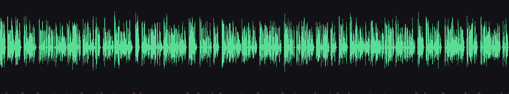
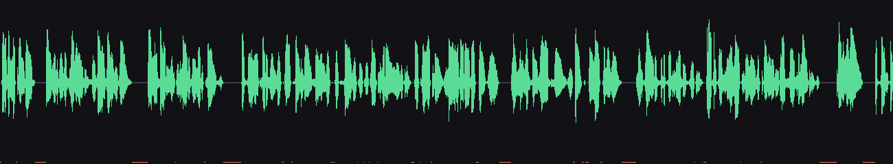

# What the reader actually heard: a captured Librera session

Captured **2026-10-13** from a real listening session. The app is **Librera Reader**
(`com.foobnix.pro.pdf.reader`), reading *The Gamers Guide to Conquest, Remastered*,
through this engine (`dev.kokoro.tts`, voice `am_adam`).

Method: `dump_audio=true` makes the engine append every buffer it hands to the
framework to `kokoro_dump.pcm`, with a sidecar giving each chunk's offset, length and
text. Started with `input keyevent KEYCODE_HEADSETHOOK`, which Librera treats as a
read-aloud toggle. Pulled and analysed with `tools/waveform.py` and a silence scan.

## The capture

**91.7 s of audio** (4,399,830 bytes), **8 chunks across 2 utterances**. The engine
reported `pauses=off inserted=0ms` for the whole session — it added nothing.

| | |
| --- | ---: |
| silence overall | 29.3 % |
| silent runs ≥150 ms | **23** |
| — of 200–300 ms | 1 |
| — of 300–400 ms | 9 |
| — of 400–500 ms | 6 |
| — of 500–600 ms | 7 |
| longest single pause | **593 ms** |
| total time in those pauses | 9.8 s of 91.7 s (10.7 %) |
| largest sample-to-sample jump | 10,998 vs peak 25,591 (43 %) |





## What this establishes

**The silence is Kokoro's, not the engine's.** `inserted=0ms` throughout, so every one
of those 23 pauses came from the model. That is roughly **one noticeable pause every
four seconds**, which is what "random silence" sounds like from the listener's side
even though each pause sits at a sentence or clause boundary.

**There is no clipping.** The largest sample-to-sample jump is 43 % of peak, which is
ordinary for high-frequency speech; a genuine cut would approach the peak. No
discontinuity is being introduced at the trims or the seams.

**The trims are behaving.** `trimFront=0–1 ms` on every chunk (the full lead-in is
kept) and `trimBack=227–313 ms` (Kokoro's 360 ms trailing padding, minus the 50 ms
guard). Nothing is being cut into.

## Two things the capture exposed that are not this engine

**1. Librera inserts its own pauses.** Its TTS settings dialog has
*"☑ A short pause after the symbol: `… ! ?`"* enabled. So around `!` and `?` the
listener gets Librera's pause *plus* Kokoro's. Worth turning off while diagnosing,
since it is app-side.

**2. Librera sends sentences with no space after the full stop.** Straight from the
sidecar, verbatim:

```
that of a lich.Undead, endlessly regenerating, and very very strong.My new body is
Hey Player Two, sorry about all that.Don't worry, Lucille has been dragged home
Shiro's eternally smug voice announces.Turning around, the first thing I see
ignoring him entirely.ISIS System booting up.
```

`lich.Undead`, `strong.My`, `announcing.Turning`, `entirely.ISIS`. The G2P sees
`lich.Undead` as one token run. That is a text-extraction artefact on the app's side
and may well affect pronunciation, though it is not what causes the pauses.

## What to do

Set **Pauses between chunks → Longest pause allowed inside Kokoro's own audio** to
350 ms. That shortens the nine 500–600 ms pauses and the six 400–500 ms ones while
leaving ordinary sentence pauses alone. It was set to 350 ms on the device at the end
of this session.

A re-capture with the cap active was attempted for a direct comparison, but Librera's
read-aloud toggle stopped responding to `KEYCODE_HEADSETHOOK` after the first session
and the engine never received a second utterance. **The cap's effect is therefore
installed but not measured here**; the earlier controlled test showed it capping the
longest pause to exactly the configured value.

## What is not measured

* **No listening test.** These are waveform and silence statistics.
* **One session, one book, one voice.** 92 s is enough to characterise pause
  frequency, not every failure mode.
* **The app's own pause length was not measured.** Librera's "short pause after the
  symbol" has no exposed duration, so its contribution is unquantified — only known
  to be non-zero and additive.
* **Captured audio is what the engine produced**, not what the speaker emitted.
  Anything the audio HAL, a Bluetooth codec or the speaker does afterwards is outside
  this capture.
