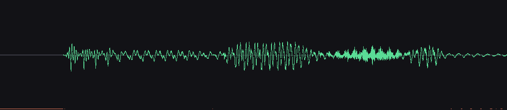
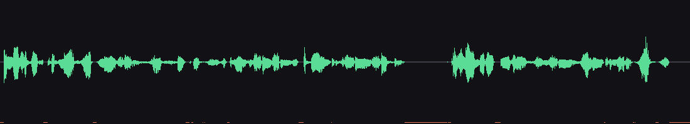
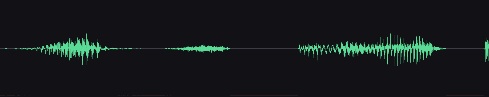
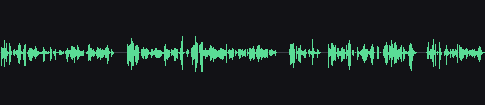

# Looking at the audio instead of only measuring it

Date: 2026-10-12. Tool: `tools/waveform.py` (numpy + stdlib zlib; no matplotlib or
Pillow). Renders a min/max envelope per pixel column, with a band along the bottom
marking where the signal is below the silence threshold, and optional time markers.

Every claim below is a picture of audio produced by the real engine on a real device,
pulled off the phone, not a simulation.

## 1. The first word is not clipped



First 400 ms of the utterance. There is roughly 48 ms of lead-in silence (the flat
run at the left, also marked by the orange band), and then the amplitude **ramps up
gradually** into the word. That ramp is the point: a clipped onset would jump
straight from silence to large amplitude at the boundary.

This is what the `FIRST_CHUNK_LEAD_IN_MS` fix was for. The engine keeps 80 ms of
lead-in on the first chunk so the output path can start before speech arrives.

## 2. Kokoro's padding is real, and visible



One chunk straight from the server, untrimmed: 9.10 s. Note the **flat tail** on the
right — the 360 ms of trailing silence Kokoro appends to every chunk, plus 50 ms at
the front. A seam between two untrimmed chunks therefore carries 410 ms of silence
nobody asked for, which is why turning this engine's own pauses off appeared to do
nothing until the padding was trimmed.

## 3. A seam looks like a notch, not a hole



One second spanning a chunk join, at 8.845 s. The orange vertical line marks the
seam. There is a bounded quiet notch of roughly the configured 90 ms, and speech
resumes immediately on both sides. Compare with what an untrimmed seam would show:
the flat tail of §2 followed by the flat head of the next chunk.

## 4. The whole utterance



22.69 s, three chunks. Pauses are visible as gaps in the envelope and as orange
markings along the bottom. Nothing here is unexpected; the picture is included
because "33 % of the span is below the silence threshold" reads very differently as
a number than as a picture of ordinary speech with ordinary pauses in it.

## Reproducing

```sh
# whole file
.tooling/kokoro-venv/bin/python tools/waveform.py audio.wav --out wave.png

# a zoom, with a marker at a known seam
.tooling/kokoro-venv/bin/python tools/waveform.py audio.wav \
    --out seam.png --start 8.35 --end 9.35 --mark 8.845

# raw PCM straight from the server, before any trimming
.tooling/kokoro-venv/bin/python tools/waveform.py chunk.raw --out raw.png
```

Reading a waveform this way is how the trimming bugs in this session were confirmed:
the numbers said `trimmed=890 ms`, but only the picture showed that the lead-in
survived and the onset was intact.
